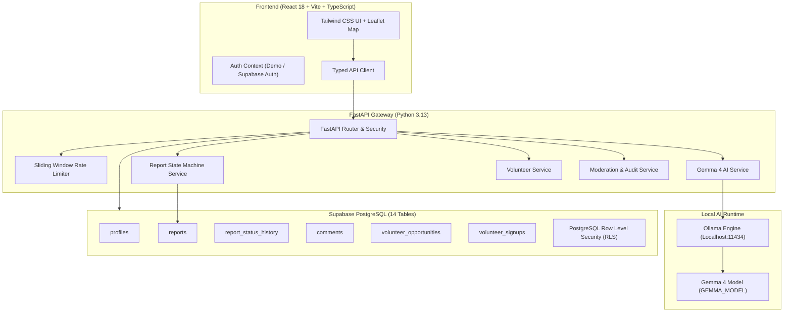

# HelpHub AI — Community Problem Solver

> **"Report a problem. Find a solution. Build a better community."**

[](https://vercel.com/sivachinni9937-beep/helphub-ai-frontend/J3ybnr9AgmbqxVZ9yaLQpfeHPQML)
[](https://helphub-ai-backend-1.onrender.com)
[](https://helphub-ai-backend-1.onrender.com/docs)
[](https://helphub-ai-backend-1.onrender.com/api/health)

### 🌐 Live Production Deployments
- **Live Frontend Application**: [https://helphub-ai-frontend.vercel.app](https://helphub-ai-frontend.vercel.app)
- **Vercel Deployment**: [https://vercel.com/sivachinni9937-beep/helphub-ai-frontend/J3ybnr9AgmbqxVZ9yaLQpfeHPQML](https://vercel.com/sivachinni9937-beep/helphub-ai-frontend/J3ybnr9AgmbqxVZ9yaLQpfeHPQML)
- **Backend API URL**: [https://helphub-ai-backend-1.onrender.com](https://helphub-ai-backend-1.onrender.com)
- **Interactive Swagger Documentation**: [https://helphub-ai-backend-1.onrender.com/docs](https://helphub-ai-backend-1.onrender.com/docs)
- **API Health Telemetry**: [https://helphub-ai-backend-1.onrender.com/api/health](https://helphub-ai-backend-1.onrender.com/api/health)

HelpHub AI is an open-source, full-stack social-impact platform where citizens, college students, NGOs, community organizations, and local volunteers collaborate to identify and resolve community problems:
- **Sanitation and garbage accumulation** near public spaces and bus stops.
- **Damaged roads and dangerous potholes**.
- **Water pipeline bursts and leaks** wasting potable drinking water.
- **Broken streetlights** causing safety hazards at night.
- **Inaccessible footpaths and damaged wheelchair ramps** at clinics and public offices.
- **Public park maintenance** and revitalization.

The platform uses local **Google Gemma 4** models running through **Ollama** to help citizens structure problem descriptions, detect categories, propose advisory urgencies, provide multilingual translations across **English, Hindi (हिन्दी), and Odia (ଓଡ଼ିଆ)**, summarize discussions, and draft formal complaint letters for personal filing.

---

## Architecture Overview



---

## Key Features

1. **Dual Operational Modes**:
   - **Demo Mode (Out-of-the-Box)**: Zero setup required! Preloaded with realistic civic issues across Bhubaneswar, Cuttack, and Mumbai in English, Hindi, and Odia. Includes instant one-click login for all 5 roles (`Citizen`, `Volunteer`, `NGO Organizer`, `Moderator`, `Admin`). If Ollama is offline, smart heuristic NLP automatically handles category inference and translations.
   - **Live Mode**: Connects to your live Supabase PostgreSQL database, Supabase Auth tokens, and real Ollama Gemma 4 runtime.
2. **Gemma 4 AI Engine**:
   - **Task A (Structure Complaint)**: Parses raw text, detects category, proposes advisory urgency, drafts translations (EN, HI, OR), and recommends actionable next steps.
   - **Task B (Multilingual Translation)**: Preserves factual numbers, names, and uncertainty across English, Hindi, and Odia.
   - **Task C (Discussion Summaries)**: Summarizes community discussions into main concerns and proposed fixes without hallucinating consensus.
   - **Task D (Complaint Letters)**: Drafts polite, formal letters to municipal ward authorities.
   - **Task E (Cautious Image Understanding)**: Identifies visible conditions with safety disclaimers.
3. **Transparent State Machine**:
   - Append-only status transition history: `Open` ➔ `In Progress` ➔ `Resolved` (with distinction between `Community Solution Reported` vs `Officially Resolved`).
4. **Volunteer Drive Coordination**:
   - NGO organizers schedule cleanups and paint drives with capacity limits, preventing overbooking and duplicate registrations.
5. **Location Privacy & Accessibility**:
   - Discloses only approximate public street coordinates or landmarks. Never exposes private home addresses without consent. Target WCAG 2.2 AA accessible design.

---

## User Roles & Permissions

| Role | Permissions |
| ---- | ----------- |
| **Guest** | Browse public feed, view impact statistics, filter by category/location. |
| **Citizen** | Submit reports, request AI structuring, follow reports, comment, draft complaint letters. |
| **Volunteer** | All citizen features + discover volunteer drives, register, manage participation. |
| **NGO Organizer** | Create scheduled volunteer drives, update report status with audit notes, view participants. |
| **Moderator** | Review flagged content and abuse reports, hide inappropriate comments. |
| **Administrator** | Access system health, aggregate platform metrics, security audit logs. |

---

## Quickstart & Local Setup

### Prerequisites

- **Node.js** 18+ (tested on Node v24) and **npm**
- **Python** 3.11+ (tested on Python 3.13)
- *(Optional)* **Ollama** installed with `gemma4` or `gemma2` model tag.

### 1. Clone the Repository

```bash
git clone https://github.com/your-username/helphub-ai.git
cd helphub-ai
```

### 2. Backend Setup (FastAPI)

```bash
# Navigate to backend and create virtual environment
cd backend
python -m venv .venv

# Activate virtual environment
# Windows (PowerShell):
.venv\Scripts\Activate.ps1
# Linux / macOS:
source .venv/bin/activate

# Install dependencies
pip install -r requirements.txt

# Run backend tests
pytest tests -v

# Start FastAPI development server (runs on http://localhost:8000)
uvicorn app.main:app --reload --port 8000
```

### 3. Frontend Setup (React + Vite)

In a new terminal window:

```bash
cd frontend

# Install npm dependencies
npm install

# Run frontend tests
npm run test

# Start frontend development server (runs on http://localhost:5173)
npm run dev
```

Visit **`http://localhost:5173`** in your browser.

---

## Testing

HelpHub AI includes automated tests covering critical paths, schemas, role-based security, state machine transitions, and AI fallbacks.

```bash
# Run backend tests (25 test cases)
backend\.venv\Scripts\pytest backend\tests -v
```

Test coverage includes:
- AI output parsing and Pydantic validation
- Graceful heuristic fallbacks when Ollama is offline
- Status transition state machine rules (illegal status jumps rejected)
- Role elevation protection (ordinary citizens cannot self-promote or mark reports officially resolved)
- Duplicate volunteer signup prevention and capacity limits
- Health and telemetry endpoints

---

## Gemma 4 / Ollama Integration

HelpHub AI isolates the local AI runtime so model configuration can change via environment variables without altering application code:

```env
OLLAMA_BASE_URL=http://localhost:11434
GEMMA_MODEL=gemma4
AI_TIMEOUT_SECONDS=60
AI_MAX_INPUT_CHARS=5000
AI_RATE_LIMIT_PER_MINUTE=20
```

### Verifying Ollama Locally

1. Install Ollama from [ollama.com](https://ollama.com).
2. Pull your chosen Gemma variant:
   ```bash
   ollama pull gemma4
   # or lightweight 2B version:
   ollama pull gemma2:2b
   ```
3. Start the Ollama server:
   ```bash
   ollama serve
   ```
4. Verify by visiting `http://localhost:8000/api/health`. The response will report `ai_runtime.connected: true` and `model_installed: true`.

---

## Supabase Database Migrations

The full normalized PostgreSQL schema with Row Level Security (RLS) policies and seed data is located in:
- `supabase/migrations/20261028000000_initial_schema.sql`
- `supabase/seed.sql`

To apply to your Supabase project:
1. Open the **SQL Editor** in your Supabase dashboard.
2. Run `supabase/migrations/20261028000000_initial_schema.sql`.
3. *(Optional)* Run `supabase/seed.sql` to populate demonstration reports and volunteer opportunities.

---

## Contributing & Hacktoberfest

We welcome your contributions! Please see [CONTRIBUTING.md](CONTRIBUTING.md) and [CODE_OF_CONDUCT.md](CODE_OF_CONDUCT.md).

## License

This project is licensed under the [MIT License](LICENSE).

